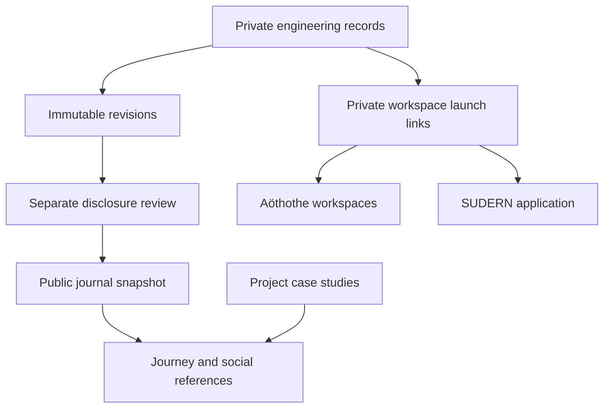

# Engineering journey and private operating workspace

Prepared 18 November 2026, Africa/Blantyre. This is an additive foundation in ChrispinePortfolio, stacked on the project-casebook reader. It does not certify the whole technology estate or claim production activation.

The portfolio should make the engineering work understandable and commercially useful. The private workspace should make today's commitments and evidence manageable. Aöthothe's commercial authority and SUDERN's programme authority remain in their own applications; a context tag in a personal record does not grant either authority.

| Surface | Responsibility | Access and data boundary |
| --- | --- | --- |
| `/portfolio` and project cases | Reviewed delivery evidence, screenshots, architecture and qualified business outcomes | Existing public evidence gate; 16 case studies from the preceding slice |
| `/journey`, `/journey/:slug` | Practical field notes, written walkthroughs and social video references | Only separately reviewed publication snapshots; no private record projection |
| `/admin/workspace` | Personal coordination, engineering diary and daily operations | Database session, explicit permissions and owner-isolated records |
| Existing communications, CRM, Treasury & ROIC | Communications work and governed commercial/financial records | Existing independent permissions and controls; the time ledger does not write financial balances |
| Aöthothe Revenue Execution and Operating Control Sites | Existing owner-restricted commercial and operating workspaces | Verified owner-private launch links in the private connections view; no data synchronization or public embedding |
| Aöthothe Enterprise OS and SUDERN | Company delivery/governance and institutional operations | Public case-study links describe known source and release evidence; no automatic import of private operational data |

## Implemented behavior

| Module | Working behavior | Limit or external dependency |
| --- | --- | --- |
| Engineering diary | Objective, investigation, lesson, next step, evidence and immutable revisions | Estimates are not counted twice as time entries |
| Delivery tasks | Acceptance criteria, result, named accountability, prerequisites and priority | Same-owner/context links; dependency cycles rejected; named accountability does not delegate another user's access |
| Daily work ledger | Actual minutes, category, concrete result, related records and current-page export | Maximum 1,440 minutes across all contexts per day; no invented financial saving or productivity score |
| Risks and decisions | Likelihood/impact, response trigger, mitigation, alternatives, rationale and review dates | Self-authored assessments; no prediction engine or automated investment decision |
| Meetings | Agenda, timestamps with offsets, minutes and linked follow-up tasks; ICS export | Download only; does not send invitations, write a calendar or notify participants |
| Presentations | Audience, intended decision, outline, run of show, speaker notes and keyboard rehearsal | Outline rehearsal; no PowerPoint-file rendering, remote hardware control or video conferencing |
| Content studio | Topic, script, transcript, destination and reviewed public copy | YouTube/Vimeo load only after a click; Facebook/Instagram/TikTok/LinkedIn use external link cards, not arbitrary embed HTML; no social publishing credentials |
| AI review | Purpose, provider/model used elsewhere, classification, output summary, reported MWK cost and human verdict | No model provider connected, autonomous agent, personality inference or guaranteed output accuracy |
| Asset register | Physical, endpoint, network, server, application, database and cloud layers; criticality, authorization and recovery notes | Manual inventory only; telemetry and firewall controls cannot be marked connected |
| Security observations | Authorized asset, observed facts, source, severity, triage and recorded response | No traffic inspection, packet capture, attack attribution or automatic blocking |
| Skills and deliberate practice | Goal, exercise, mistake/correction, self-assessed confidence and authorized scope | No professional certification or automatic proof of skill |
| Daily overview | Database aggregates, recorded effort and three rule-ranked task actions | Transparent priority/overdue/blocked rules; not AI or a predictive model; missing data is not simulated |

## Visual and performance direction

The public journal uses ivory, forest green, restrained gold, large editorial typography and a real project interface. Image sizing follows the container rather than stretching content. The private workspace uses the same restrained palette inside the protected admin shell, with clear form labels and separate views for each operating record. Empty and failed states are different. No dashboard metric is fabricated to make the interface appear active.

Public route modules preload on pointer or keyboard intent. Data Saver and slow connections suppress preloading. Authenticated records and third-party video players are never prefetched by this mechanism. This is a bandwidth-conscious optimization, not a machine-learning prediction system; no measured loading-time saving has been claimed.

## Backend and data controls

- Reuse database-backed sessions and role permissions. New engineering permissions go only to the existing administrator roles. Every private query and write also checks the record owner.
- Validate strict per-kind schemas, bounded strings, dates, HTTPS references and credential-shaped input. These checks reduce accidental exposure; they are not a complete secret scanner.
- Require configured same-origin JSON mutations, expected record versions and request keys. Serialize an actor's transactions through a database row lock. Replays return the recorded response; changed request-key payloads and stale revisions fail with HTTP 409.
- Apply a shared database-backed limit of 60 successful mutations per actor per minute. Existing login throttling remains separate. Edge DDoS controls and global API quotas are not provided by this change.
- Append private history and concise audit events. PostgreSQL triggers reject revision-history edits/deletes, record identity changes and publication snapshot rewrites/deletes. These controls do not prevent a database owner from altering the schema.
- Serve public snapshots through an allowlist. Editing a private record cannot silently change an already published note. Withdrawal removes public serving while preserving the audit record; it cannot recall third-party screenshots or caches.
- Return safe API errors with a request ID; do not send raw driver errors, request bodies or database URLs to the client. Hide malformed/oversized request details. Private APIs use `Cache-Control: no-store`; login/logout clears cached private queries.
- Restrict media origins, reject arbitrary HTML, and constrain frame, object, base, form and browser-feature policies. The wider application still permits inline scripts/styles and needs a separately tested nonce policy before claiming a strict CSP.

Deployment, backup restoration, least-privilege runtime database roles, production cookie/proxy behavior, full estate logging, alert delivery and incident response exercises require their own evidence. Local and isolated tests do not establish those outcomes.

Read [OPERATING-STRATEGY.md](OPERATING-STRATEGY.md), [RELEASE.md](RELEASE.md), and [VERIFICATION.md](VERIFICATION.md) before activating this slice.

Design references: [OWASP error handling](https://cheatsheetseries.owasp.org/cheatsheets/Error_Handling_Cheat_Sheet.html), [OWASP REST security](https://cheatsheetseries.owasp.org/cheatsheets/REST_Security_Cheat_Sheet.html), and [YouTube player parameters](https://developers.google.com/youtube/player_parameters). Product behavior above is established by this repository's source and verification, not inferred from those references.
