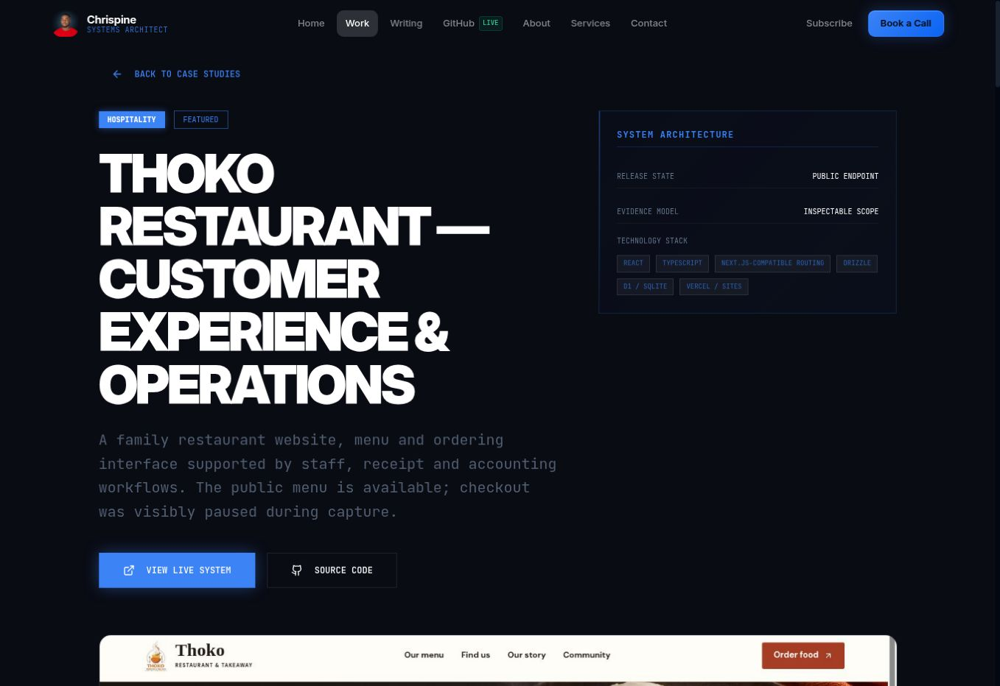
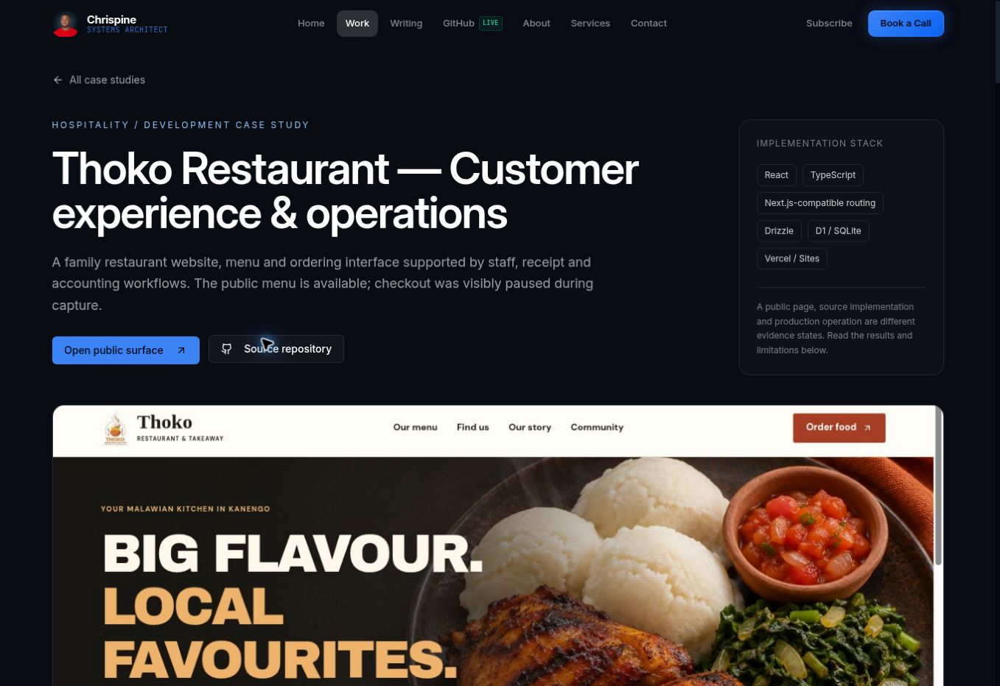
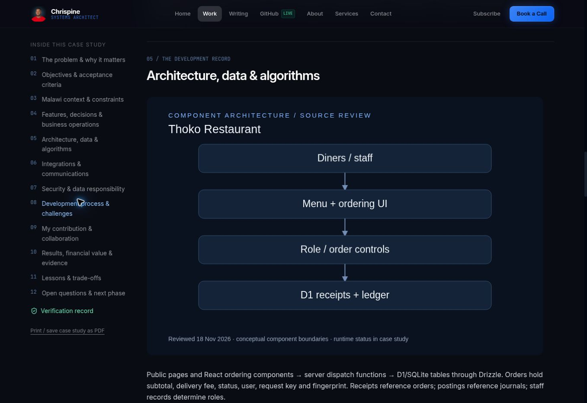

# Portfolio documentation verification — 18 November 2026

**Published content: PASS. Rich-reader deployment: BLOCKED.**

| Boundary | Evidence and result |
| --- | --- |
| Source inventory | 25 accessible repositories and 15 Vercel projects audited; related versions/templates/reference code mapped in README |
| Editorial catalogue | 16 distinct case studies, 18 question mappings, 12 project image assets and 16 labelled architecture diagrams |
| Screenshot limits | 11 current public captures; one archived MEC training login; six source-only cases have no current product screenshot |
| Isolated publication | 16 published/public/approved case studies, 16 public evidence records and 16 import audit events on a child database branch |
| Safe-import regression | Full batch rollback after concurrent edit, idempotent rerun, exact timestamp lease, changed-content revision rejection, old evidence withdrawal and audit preservation passed |
| Live content publication | Same reviewed atomic batch executed against the verified portfolio database; 16 published/public/approved studies and 16 audited imports confirmed |
| Public API | `/api/portfolio` returned 16; search page 2 returned four records with total=16; Thoko detail returned two image URLs, one approved evidence record and complete readable long-form solution |
| Public disclosure boundary | Private project ID, commercial value and evidence source reference absent from detail projection |
| Asset delivery | Public raw screenshot URL returned HTTP 200; screenshot and cover delivery observed in the public portfolio |
| TypeScript | PASS |
| Tests | PASS: 74 tests across seven files |
| Build | PASS |
| New-reader browser QA | Read-only fixture preview: catalogue, second-page projects, search, detail sections, screenshot gallery, architecture navigation and loaded diagram observed on desktop |
| Live browser readback | Published Thoko case and updated catalogue observed on the existing production frontend |
| Production-classified dependency audit | FAIL: 10 high findings in the picomatch dependency chain |
| Full dependency audit | FAIL: 13 high and six moderate findings |
| Automatic Vercel preview | ERROR for `27ea0601e44b21b19601a0000e333c020513127b`, deployment `dpl_AHAPMpkHc9XRzW43aygoVN13cX3V`; build logs end with 10 high findings and `npm run verify:release` exit 1 |
| Merge / new frontend deployment | Not performed; draft PR #29 retains existing gates |

The old deployed frontend can read the complete casebook through the backward-compatible `solution` field and uses the reviewed cover URL. It does not yet render the new structured dossier navigation or screenshot gallery. Those richer components are shown only in the local fixture screenshots below. No production financial endpoint, account permission, environment value or GitHub workflow was changed. No workflow was manually rerun.

## Remaining work

1. Resolve the dependency audit through reviewed compatible upgrades or the repository’s accountable release process. Do not suppress the finding or bypass `verify:release` to publish this reader.
2. Deploy the exact reviewed head and repeat public browser checks on that deployment, including small-screen layout and screenshot/diagram delivery.
3. Obtain current, de-identified product screenshots for the six source-only projects, and authenticated operating evidence where required. MEC’s training capture is historical; SUDERN’s public image is only a canary.
4. Obtain actual costs, development times, client approvals, operating records and comparable before/after measurements before asserting fees collected, ROI, adoption or savings.

Database publication is an editorial content action under the user’s portfolio-documentation request. It does not authorize or claim production financial activation for any project.
